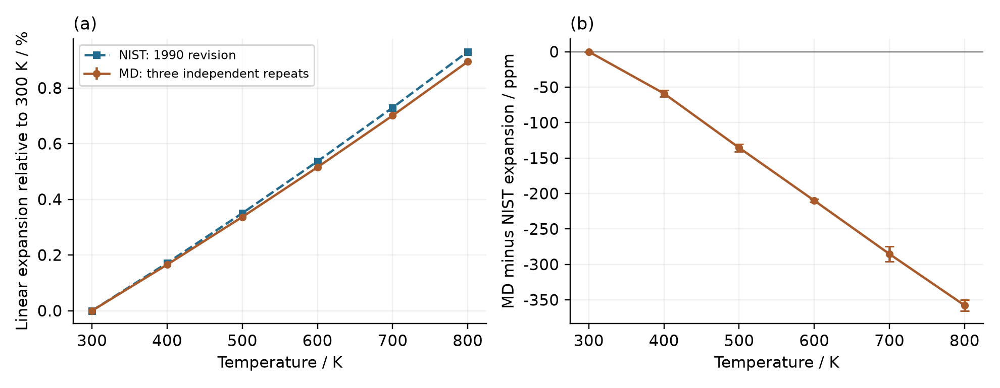

# 阶段进展

正式及验证轨迹完成 **24/24**。

300–800 K平均线膨胀系数：**17.8883 ×10⁻⁶ K⁻¹**；95%统计区间半宽0.0151 ×10⁻⁶ K⁻¹。NIST同定义参考18.6038 ×10⁻⁶ K⁻¹；偏差-3.85%。三项端点验证通过：**True**。

|验证项目|平均系数相对基准r1的变化|
|---|---|
|尺寸：4000→6912原子|+0.0680%|
|时间步：1→0.5 fs|-0.0087%|
|时长：延长至1+1 ns|+0.0280%|

Notebook论文已扩写为全英文稿，正文约4000英文词（含摘要与图表说明，不含参考文献和补充材料），含3张正文图、2张补充图、2张正文表及108行可执行代码。[排版阅读版HTML](results/copper_thermal_expansion_paper.html)需下载后用浏览器打开；其中代码默认折叠，可点击展开。小组成员姓名、单位与实际分工仍需组员填写。

最后核查时间（UTC）：2026-10-19T02:36:25.693653+00:00

|任务|状态|
|---|---|
|prod_T300_r1|completed|
|prod_T400_r1|completed|
|prod_T500_r1|completed|
|prod_T600_r1|completed|
|prod_T700_r1|completed|
|prod_T800_r1|completed|
|prod_T300_r2|completed|
|prod_T400_r2|completed|
|prod_T500_r2|completed|
|prod_T600_r2|completed|
|prod_T700_r2|completed|
|prod_T800_r2|completed|
|prod_T300_r3|completed|
|prod_T400_r3|completed|
|prod_T500_r3|completed|
|prod_T600_r3|completed|
|prod_T700_r3|completed|
|prod_T800_r3|completed|
|val_size12_T300|completed|
|val_dt05_T300|completed|
|val_long_T300|completed|
|val_size12_T800|completed|
|val_dt05_T800|completed|
|val_long_T800|completed|